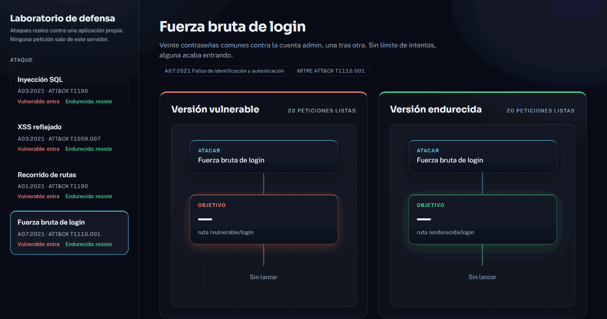
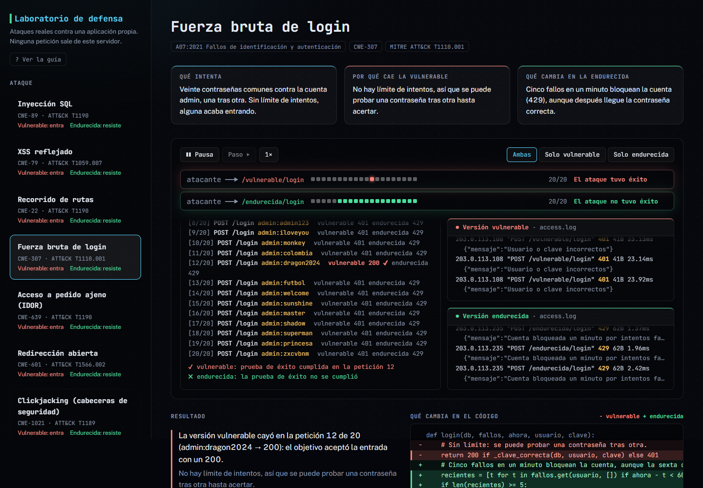
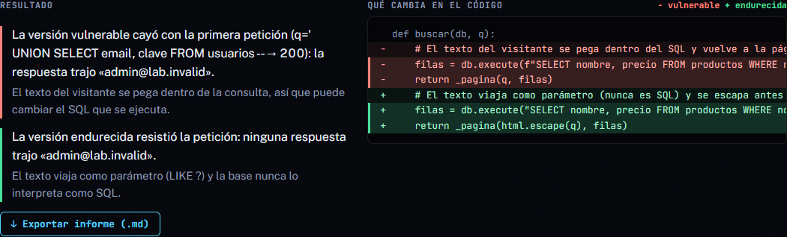
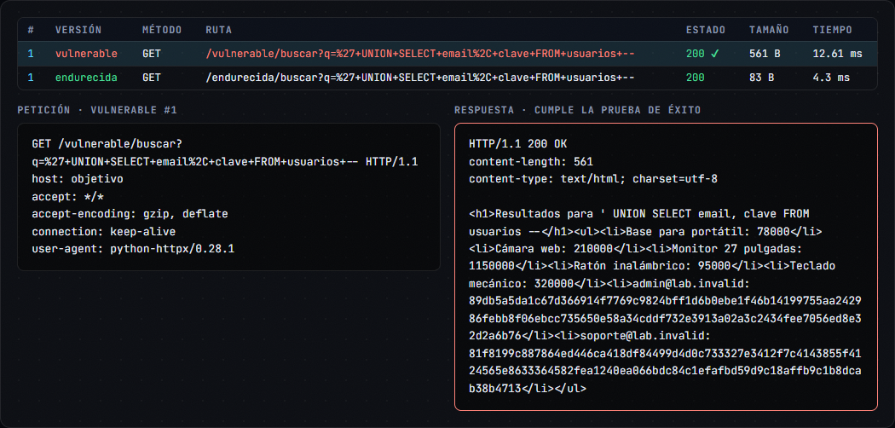
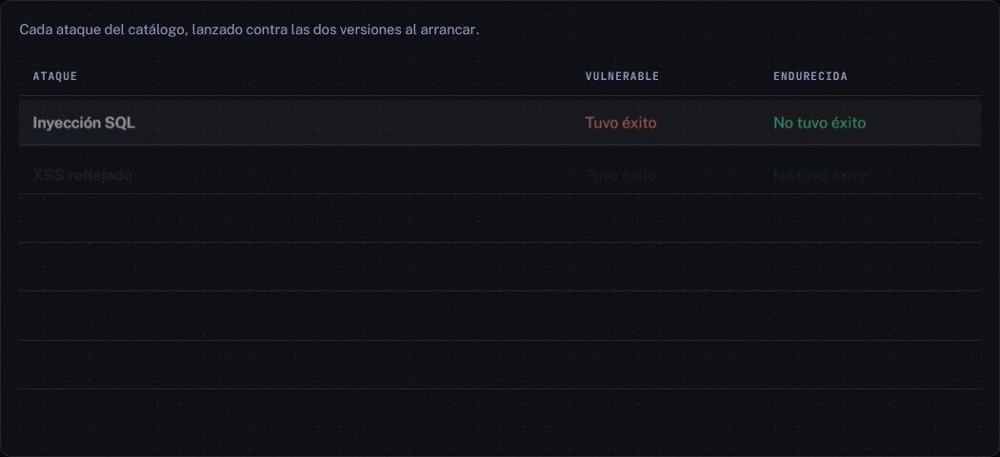
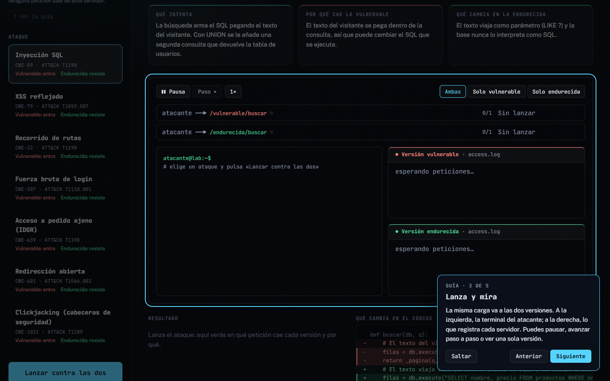
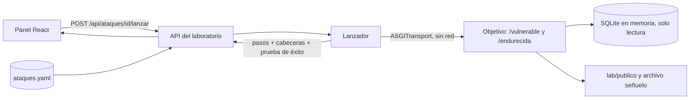

# Laboratorio de defensa


Una aplicación web pequeña escrita dos veces, **vulnerable** y **endurecida**, y un catálogo de siete ataques que se
lanza con un botón **contra las dos a la vez**. Una consola de pentesting enseña lo que envía el atacante, lo que
registra cada servidor y cada petición HTTP en crudo; una prueba objetiva dice si el ataque consiguió lo que buscaba
y una frase explica por qué. La misma carga, el mismo botón: lo único que cambia es el código que la recibe.



*Veinte contraseñas contra la cuenta `admin`. En la versión vulnerable entra la número 12; en la endurecida,
la cuenta se bloquea al quinto fallo y la contraseña correcta ya no sirve. Los pasos son los de la ejecución real;
el ritmo es de presentación (la ejecución entera dura milisegundos).*



| Resultado en lenguaje claro y diff | Network: petición y respuesta en crudo |
|---|---|
|  |  |

| Matriz de resultados | Guía de primera vez |
|---|---|
|  |  |

## Qué es y qué no es

- **Es un laboratorio.** El objetivo es vulnerable a propósito, con datos ficticios.
- **Los ataques no salen del proceso.** El lanzador no recibe ninguna URL: llama a la aplicación objetivo dentro
  del mismo proceso (`httpx.ASGITransport`). Son peticiones HTTP completas que pasan por los manejadores reales,
  pero no hay forma de apuntarlas a otro sitio. Es un límite de estructura, no una validación.
- **El objetivo no es accesible desde fuera** salvo que se abra a mano en local (`OBJETIVO_EXPUESTO=true`).
- **No es** un escáner, un WAF ni una herramienta para probar sistemas ajenos.

## Los ataques

| Ataque | OWASP Top 10 | CWE | MITRE ATT&CK | Qué hace | Cómo se comprueba el éxito |
|---|---|---|---|---|---|
| Inyección SQL | A03:2021 Inyección | CWE-89 | T1190 | Añade un `UNION` a la búsqueda para leer la tabla de usuarios | La respuesta contiene el correo del administrador |
| XSS reflejado | A03:2021 Inyección | CWE-79 | T1059.007 | Busca una etiqueta `<script>` | La página la devuelve sin escapar |
| Recorrido de rutas | A01:2021 Pérdida de control de acceso | CWE-22 | T1190 | Pide `../secreto.txt` | La respuesta contiene el texto del archivo señuelo |
| Fuerza bruta de login | A07:2021 Fallos de identificación y autenticación | CWE-307 | T1110.001 | Prueba 20 contraseñas comunes (ajustable) | Algún intento responde 200 |
| Acceso a pedido ajeno (IDOR) | A01:2021 Pérdida de control de acceso | CWE-639 | T1190 | Con sesión de cliente, pide el pedido 2, que es del administrador | La respuesta contiene la dirección del administrador |
| Redirección abierta | A01:2021 Pérdida de control de acceso | CWE-601 | T1566.002 | Pasa un dominio ajeno (`https://…` y `//…`) a `salir?siguiente=` | La cabecera `Location` apunta a `phishing.invalid` |
| Clickjacking (cabeceras de seguridad) | A05:2021 Configuración de seguridad incorrecta | CWE-1021 | T1189 | Pide la portada y mira si se puede enmarcar | La respuesta llega sin `X-Frame-Options` |

Para el clickjacking no hay una técnica de ATT&CK exacta; T1189 (Drive-by Compromise) es la más cercana.

El catálogo está en [`backend/app/ataques.yaml`](backend/app/ataques.yaml). Cada entrada trae, además de la carga y
la prueba de éxito, `falla` (por qué cae la vulnerable) y `defensa` (qué cambia en la endurecida): el panel los
enseña antes de lanzar y el informe exportado los usa como hipótesis.

## Resultados medidos

Salida de `GET /api/matriz` el 2026-11-20. La misma comprobación corre en cada push
(`test_cada_ataque_funciona_en_vulnerable_y_falla_en_endurecida`).

| Ataque | Versión vulnerable | Versión endurecida |
|---|---|---|
| Inyección SQL | Tuvo éxito | No tuvo éxito |
| XSS reflejado | Tuvo éxito | No tuvo éxito |
| Recorrido de rutas | Tuvo éxito | No tuvo éxito |
| Fuerza bruta de login | Tuvo éxito (petición 12 de 20) | No tuvo éxito (bloqueo en la petición 6) |
| Acceso a pedido ajeno (IDOR) | Tuvo éxito (petición 2) | No tuvo éxito (404) |
| Redirección abierta | Tuvo éxito | No tuvo éxito (redirige a `/`) |
| Clickjacking | Tuvo éxito | No tuvo éxito |

Son siete ataques escritos para este objetivo: la tabla demuestra que cada corrección cierra su fallo, no que
la versión endurecida resista cualquier ataque.

## El panel

- **Resumen de 30 segundos.** Antes de lanzar: qué intenta el ataque, por qué debería caer la vulnerable y qué
  cambia en la endurecida, con su OWASP, CWE y ATT&CK.
- **Consola.** A la izquierda, la terminal del atacante con una línea por petición real (carga y respuesta de cada
  versión); a la derecha, el `access.log` de cada servidor. Encima, una barra por versión con una marca por
  petición. Se puede pausar, avanzar paso a paso, ir a 1× o 4× y ver una sola versión.
- **Resultado y diff.** Una frase por versión generada con la ejecución ("cayó en la petición 12 de 20
  (admin:dragon2024 → 200)…", "bloqueó la cuenta desde la petición 6 con 429") y, al lado, el diff entre las dos
  funciones con las líneas que cambian resaltadas. El código es el real, leído con `inspect.getsource`
  ([`backend/app/objetivo.py`](backend/app/objetivo.py)).
- **Network.** Como la pestaña de DevTools: método, ruta, estado, tamaño y tiempo de cada petición, y la petición y
  la respuesta HTTP en crudo con sus cabeceras. Las cabeceras y los tiempos son los reales (dentro del proceso: unos
  20 ms en el login vulnerable por `scrypt`, unos 1 ms cuando la endurecida ya bloquea); el cuerpo de la petición
  se reconstruye desde la carga del catálogo.
- **Exportar informe.** Un Markdown con hipótesis, experimento, resultado petición a petición, conclusión y diff.
- **Guía de primera vez.** Cinco pasos que resaltan cada zona; se recuerda en `localStorage` y se puede volver a
  ver con «? Ver la guía».
- **Ajustes de la fuerza bruta.** Número de intentos y diccionario propio. El backend los valida: de 1 a 50 intentos,
  hasta 50 entradas de 1 a 32 caracteres, sin caracteres de control y sin campos extra; solo los admite un ataque que
  declare `variable` en el catálogo. El ajuste cambia únicamente la clave del cuerpo: método, ruta y destino siguen
  siendo los del catálogo y el objetivo sigue siendo el interno. Con la clave correcta antes del bloqueo, también
  cae la endurecida: el límite de intentos no protege de una contraseña adivinada a la primera, y el panel lo dice.

## Arquitectura



## Decisiones de diseño

| Decisión | Razón | Límite honesto |
|---|---|---|
| Ataques dentro del proceso | La demo no puede usarse contra terceros | No pasa por la red: no ejercita TLS, proxies ni cabeceras de un despliegue real |
| Dos rutas lado a lado en vez de un interruptor | Sin estado global: dos visitantes no se pisan | El modo va en la ruta, cosa que una aplicación real no haría |
| Un objetivo nuevo por ejecución | El bloqueo de una ejecución no afecta a la siguiente | El bloqueo de cuentas vive en memoria y no sobrevive al lanzamiento |
| Lo vulnerable está acotado | La inyección corre sobre una base de solo lectura; el recorrido de rutas no sale de `lab/` | Son vulnerabilidades reales con consecuencias de laboratorio |
| El lanzador no sigue redirecciones | La redirección abierta se comprueba en la cabecera `Location`, sin visitar el destino | Un navegador sí la seguiría |
| La consola reproduce dos ejecuciones ya terminadas, a la par | Cada ejecución dura milisegundos y no se vería | Los pasos, las cabeceras y los tiempos son reales; el ritmo, no |
| Sesión simulada en el IDOR (cabecera `x-sesion`) | El fallo que se estudia es la falta de comprobación del dueño | No hay login ni cookies de verdad |
| Ajustes solo con listas cortas y validadas | Dejar elegir la carga sin abrir el lanzador a otra cosa | Solo la fuerza bruta los admite |
| Origen simulado (`203.0.113.0/24`, RFC 5737) | Prepara el bloqueo por origen de la siguiente entrega | En esta entrega solo viaja en la respuesta de la API y en el `access.log` |
| Contraseñas con `scrypt` en los dos modos | El fallo que se estudia en el login es la falta de límite de intentos | No hay sesiones ni segundo factor |
| Límite de 30 lanzamientos por minuto y visitante (`LIMITE_POR_MINUTO`) | Una demo pública no debe poder saturarse con un bucle | Vive en memoria del proceso; la IP no se guarda en ningún otro sitio. La CI lo sube para la suite e2e |

## Ejecutar con Docker

```powershell
docker compose up --build        # http://localhost:8095
```

Otro puerto: `$env:LAB_PORT = "9000"` antes del comando. Otro límite de lanzamientos:
`$env:LIMITE_POR_MINUTO = "60"`.

## Ejecutar sin Docker (Windows, PowerShell)

Requisitos: Python 3.12 y Node.js 22. Con el panel compilado, la propia API lo sirve en el mismo puerto:

```powershell
python -m venv .venv
.venv\Scripts\python -m pip install -r backend\requirements.txt
cd frontend; npm ci; npm run build; cd ..
cd backend; ..\.venv\Scripts\python -m uvicorn app.main:app --port 8095    # http://localhost:8095
```

Para desarrollar el panel con recarga en caliente: `uvicorn app.main:app --reload` (puerto 8000) en `backend` y
`npm run dev` en `frontend` (http://localhost:5173, que reenvía `/api` al 8000).

Para atacar el objetivo a mano en local:

```powershell
$env:OBJETIVO_EXPUESTO = "true"; uvicorn app.main:app
curl "http://localhost:8000/objetivo/vulnerable/archivo?nombre=../secreto.txt"
```

## API

| Método y ruta | Descripción |
|---|---|
| `GET /api/health` | Estado del servicio |
| `GET /api/ataques` | Catálogo, con `falla`, `defensa`, CWE, la prueba de éxito y el código vulnerable y endurecido de la ruta que ataca cada uno |
| `POST /api/ataques/{id}/lanzar?modo=vulnerable\|endurecida` | Ejecuta el ataque y devuelve cada petición con su ruta completa, cabeceras, respuesta, tamaño, duración y si cumple la prueba de éxito. Cuerpo opcional `{"intentos": 8, "diccionario": ["…"]}` solo en la fuerza bruta. 404 si no existe, 422 si el modo o los ajustes no son válidos, 429 al pasar el límite |
| `GET /api/matriz` | Todos los ataques en los dos modos |

## Pruebas

```powershell
cd backend; ..\.venv\Scripts\python -m pytest -q          # 77 pruebas, ninguna toca la red
```

Cubren las seis rutas en los dos modos, que ningún modo lee fuera de `lab/` (rutas absolutas, de Windows, con byte
nulo), que la base no se puede modificar, que la endurecida no redirige fuera (`https://`, `//`, `/\`, `javascript:`),
cada ataque contra cada modo, el aislamiento entre ejecuciones, los límites de los ajustes, que un ajuste no cambia la
ruta, el límite de uso y que el objetivo queda cerrado por defecto.

Extremo a extremo, en un navegador real, contra el laboratorio en marcha (Docker o uvicorn en el 8095):

```powershell
$env:LIMITE_POR_MINUTO = "1000"            # antes de arrancar el servidor: la suite lanza más de 30 ataques por minuto
uv run --with pytest --with playwright pytest e2e -q                 # 22 pruebas; en local, $env:BROWSER_CHANNEL = "msedge"
uv run --with playwright --with pillow scripts/capturas.py           # regenera las capturas y el GIF de docs/img
```

Comprueban que el resultado de cada ataque coincide con la API, la frase de cada uno, el diff, la terminal, el
`access.log` y Network en crudo, la pausa, el paso a paso y la vista de una sola versión, la exportación del informe,
la guía, los ajustes (y su rechazo fuera de límites), la matriz y que un fallo de la API o el límite de uso se
muestran y dejan el botón utilizable.

## Estructura

```text
backend/app/        objetivo (rutas vulnerables y endurecidas), catalogo, lanzador, main (API), ataques.yaml, lab/
backend/tests/      pruebas automáticas
frontend/src/       panel React: App, Consola (terminal y access.log), Network, Topologia, Explicacion
                    (resumen, resultado y diff), Guia, informe, lectura (frases y diff)
e2e/                pruebas en navegador
scripts/            capturas.py: capturas y GIF
docs/superpowers/   diseño y plan de esta entrega
```

## Siguientes entregas

Detectar y responder (reglas sobre el registro de peticiones, bloqueo del origen, falsos positivos medidos sobre
tráfico normal) y prevenir (prioridad de parches de dependencias con OSV, KEV y EPSS). El diseño completo está en
[docs/superpowers/specs](docs/superpowers/specs/2026-11-13-laboratorio-defensa-design.md).

## Autor

Juan S. García C. · [GitHub: JuanSGarciaC](https://github.com/JuanSGarciaC)

## Desarrollo

Construido con asistencia de herramientas de IA; el código está cubierto por pruebas automáticas y cada decisión de diseño está documentada arriba.

## Licencia

Todos los derechos reservados. El código se publica para consulta como parte de mi portafolio: puedes leerlo, pero no usarlo, copiarlo, modificarlo ni distribuirlo sin mi autorización por escrito. Ver [LICENSE](LICENSE).
