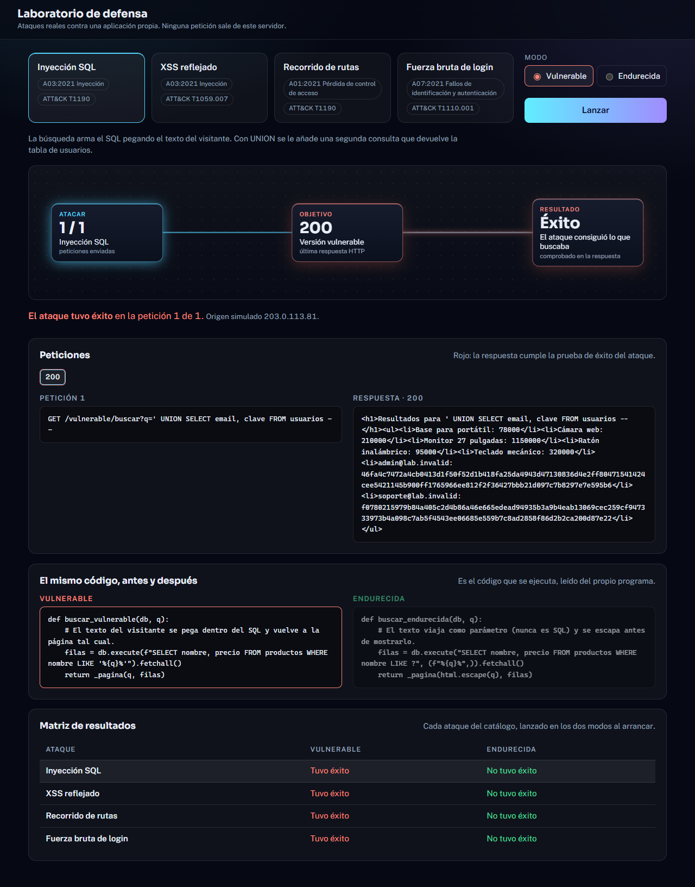
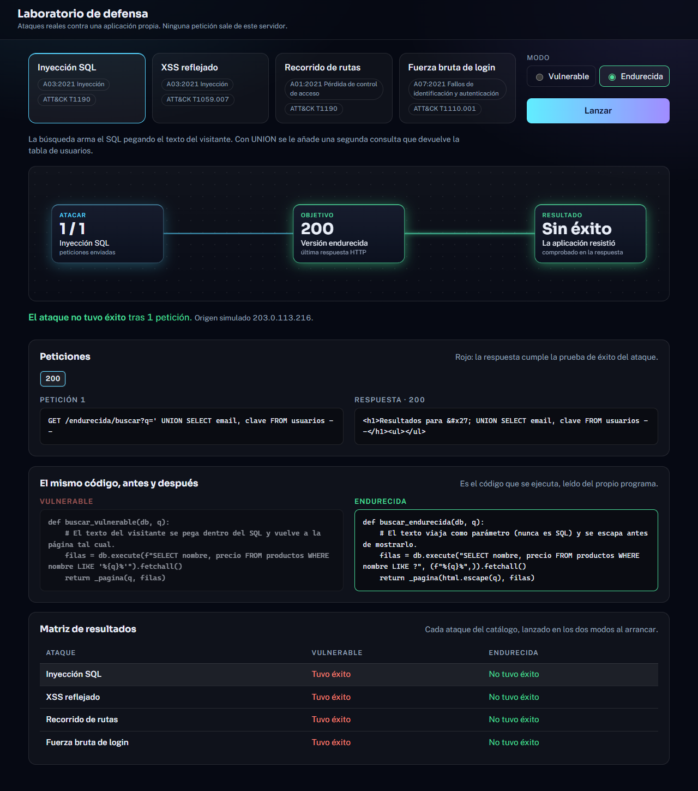
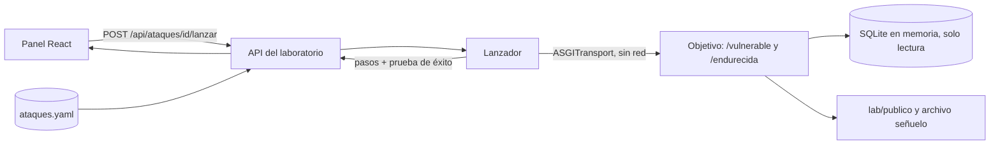

# Laboratorio de defensa


Una aplicación web pequeña escrita dos veces, **vulnerable** y **endurecida**, y un catálogo de ataques que se
lanza con un botón. El lienzo muestra cada petición viajar hasta el objetivo y una prueba objetiva dice si el
ataque consiguió lo que buscaba. La misma carga, el mismo botón: lo único que cambia es el código que la recibe.


*Veinte contraseñas contra la cuenta `admin`. En la versión vulnerable entra la número 12; en la endurecida,
la cuenta se bloquea al quinto fallo y la contraseña correcta ya no sirve. Los pasos son los de la ejecución real;
el ritmo es de presentación (la ejecución entera dura milisegundos).*

| Inyección SQL contra la versión vulnerable | La misma carga contra la versión endurecida |
|---|---|
|  |  |

## Qué es y qué no es

- **Es un laboratorio.** El objetivo es vulnerable a propósito, con datos ficticios.
- **Los ataques no salen del proceso.** El lanzador no recibe ninguna URL: llama a la aplicación objetivo dentro
  del mismo proceso (`httpx.ASGITransport`). Son peticiones HTTP completas que pasan por los manejadores reales,
  pero no hay forma de apuntarlas a otro sitio. Es un límite de estructura, no una validación.
- **El objetivo no es accesible desde fuera** salvo que se abra a mano en local (`OBJETIVO_EXPUESTO=true`).
- **No es** un escáner, un WAF ni una herramienta para probar sistemas ajenos.

## Los ataques

| Ataque | OWASP Top 10 | MITRE ATT&CK | Qué hace | Cómo se comprueba el éxito |
|---|---|---|---|---|
| Inyección SQL | A03:2021 Inyección | T1190 | Añade un `UNION` a la búsqueda para leer la tabla de usuarios | La respuesta contiene el correo del administrador |
| XSS reflejado | A03:2021 Inyección | T1059.007 | Busca una etiqueta `<script>` | La página la devuelve sin escapar |
| Recorrido de rutas | A01:2021 Pérdida de control de acceso | T1190 | Pide `../secreto.txt` | La respuesta contiene el texto del archivo señuelo |
| Fuerza bruta de login | A07:2021 Fallos de identificación y autenticación | T1110.001 | Prueba 20 contraseñas comunes | Algún intento responde 200 |

El catálogo está en [`backend/app/ataques.yaml`](backend/app/ataques.yaml): añadir un ataque es añadir una entrada.

## Resultados medidos

Salida de `GET /api/matriz` el 2026-11-13. La misma comprobación corre en cada push
(`test_cada_ataque_funciona_en_vulnerable_y_falla_en_endurecida`).

| Ataque | Versión vulnerable | Versión endurecida |
|---|---|---|
| Inyección SQL | Tuvo éxito | No tuvo éxito |
| XSS reflejado | Tuvo éxito | No tuvo éxito |
| Recorrido de rutas | Tuvo éxito | No tuvo éxito |
| Fuerza bruta de login | Tuvo éxito (petición 12 de 20) | No tuvo éxito (bloqueo en la petición 6) |

Son cuatro ataques escritos para este objetivo: la tabla demuestra que cada corrección cierra su fallo, no que
la versión endurecida resista cualquier ataque.

## El antes y el después

El panel enseña el código real de cada ruta, leído del propio programa con `inspect.getsource`
([`backend/app/objetivo.py`](backend/app/objetivo.py)). La búsqueda:

```python
def buscar_vulnerable(db, q):
    # El texto del visitante se pega dentro del SQL y vuelve a la página tal cual.
    filas = db.execute(f"SELECT nombre, precio FROM productos WHERE nombre LIKE '%{q}%'").fetchall()
    return _pagina(q, filas)


def buscar_endurecida(db, q):
    # El texto viaja como parámetro (nunca es SQL) y se escapa antes de mostrarlo.
    filas = db.execute("SELECT nombre, precio FROM productos WHERE nombre LIKE ?", (f"%{q}%",)).fetchall()
    return _pagina(html.escape(q), filas)
```

## Arquitectura



## Decisiones de diseño

| Decisión | Razón | Límite honesto |
|---|---|---|
| Ataques dentro del proceso | La demo no puede usarse contra terceros | No pasa por la red: no ejercita TLS, proxies ni cabeceras de un despliegue real |
| Dos rutas lado a lado en vez de un interruptor | Sin estado global: dos visitantes no se pisan | El modo va en la ruta, cosa que una aplicación real no haría |
| Un objetivo nuevo por ejecución | El bloqueo de una ejecución no afecta a la siguiente | El bloqueo de cuentas vive en memoria y no sobrevive al lanzamiento |
| Lo vulnerable está acotado | La inyección corre sobre una base de solo lectura; el recorrido de rutas no sale de `lab/` | Son vulnerabilidades reales con consecuencias de laboratorio |
| El lienzo reproduce una ejecución ya terminada | La ejecución dura milisegundos y no se vería | Los pasos son reales; los tiempos, no |
| Origen simulado (`203.0.113.0/24`, RFC 5737) | Prepara el bloqueo por origen de la siguiente entrega | En esta entrega solo se muestra |
| Contraseñas con `scrypt` en los dos modos | El fallo que se estudia en el login es la falta de límite de intentos | No hay sesiones ni segundo factor |
| Límite de 30 lanzamientos por minuto y visitante | Una demo pública no debe poder saturarse con un bucle | Vive en memoria del proceso; la IP no se guarda en ningún otro sitio |

## Ejecutar con Docker

```powershell
docker compose up --build        # http://localhost:8095
```

Otro puerto: `$env:LAB_PORT = "9000"` antes del comando.

## Ejecutar sin Docker (Windows, PowerShell)

Requisitos: Python 3.12 y Node.js 22.

```powershell
cd backend
python -m venv .venv
.venv\Scripts\Activate.ps1
pip install -r requirements.txt
pytest -q
uvicorn app.main:app --reload              # http://localhost:8000/docs
```

```powershell
cd frontend                                # otra terminal
npm install
npm run dev                                # http://localhost:5173
```

Para atacar el objetivo a mano en local:

```powershell
$env:OBJETIVO_EXPUESTO = "true"; uvicorn app.main:app
curl "http://localhost:8000/objetivo/vulnerable/archivo?nombre=../secreto.txt"
```

## API

| Método y ruta | Descripción |
|---|---|
| `GET /api/health` | Estado del servicio |
| `GET /api/ataques` | Catálogo, con el código vulnerable y endurecido de la ruta que ataca cada uno |
| `POST /api/ataques/{id}/lanzar?modo=vulnerable\|endurecida` | Ejecuta el ataque y devuelve cada petición, su respuesta y si cumple la prueba de éxito (404 si no existe, 422 si el modo no es válido, 429 al pasar el límite) |
| `GET /api/matriz` | Todos los ataques en los dos modos |

## Pruebas

```powershell
cd backend; pytest -q                      # 45 pruebas, ninguna toca la red
```

Cubren las tres rutas en los dos modos, que ningún modo lee fuera de `lab/` (rutas absolutas, de Windows, con byte
nulo), que la base no se puede modificar, cada ataque contra cada modo, el aislamiento entre ejecuciones, el límite
de uso y que el objetivo queda cerrado por defecto.

Extremo a extremo, en un navegador real:

```powershell
docker compose up -d --build --wait
uv run --with pytest --with playwright pytest e2e -q                 # 14 pruebas; en local, $env:BROWSER_CHANNEL = "msedge"
uv run --with playwright --with pillow scripts/capturas.py           # regenera capturas y GIF
```

Comprueban que el resultado del lienzo coincide con la API para cada ataque y modo, que la matriz del panel es la
de la API, y que un fallo de la API o el límite de uso se muestran y dejan el botón utilizable.

## Estructura

```text
backend/app/        objetivo (rutas vulnerables y endurecidas), catalogo, lanzador, main (API), ataques.yaml, lab/
backend/tests/      pruebas automáticas
frontend/src/       panel React (App, Flow)
e2e/                pruebas en navegador
scripts/            capturas.py: capturas y GIF
docs/superpowers/   diseño y plan de esta entrega
```

## Siguientes entregas

Detectar y responder (reglas sobre el registro de peticiones, bloqueo del origen, falsos positivos medidos sobre
tráfico normal) y prevenir (prioridad de parches de dependencias con OSV, KEV y EPSS). El diseño completo está en
[docs/superpowers/specs](docs/superpowers/specs/2026-11-13-laboratorio-defensa-design.md).

## Autor

Juan S. García C. · [GitHub: JuanSGarciaC](https://github.com/JuanSGarciaC)

## Desarrollo

Construido con asistencia de herramientas de IA; el código está cubierto por pruebas automáticas y cada decisión de diseño está documentada arriba.

## Licencia

Todos los derechos reservados. El código se publica para consulta como parte de mi portafolio: puedes leerlo, pero no usarlo, copiarlo, modificarlo ni distribuirlo sin mi autorización por escrito. Ver [LICENSE](LICENSE).
